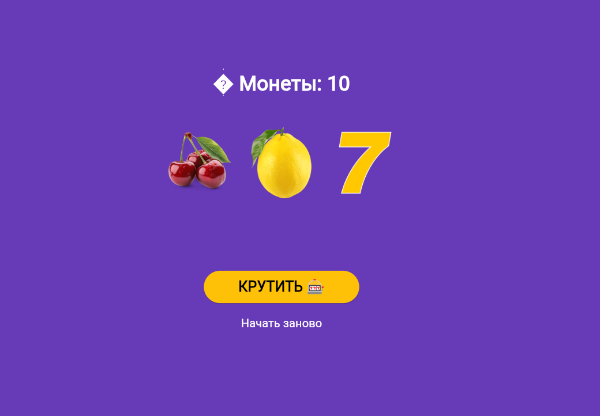

# Лабораторная работа №9. Flutter: StatefulWidget и управление состоянием
**автор:** Донскова Ульяна ИСП-242
**Дата сдачи:** 09.11.2026

## Что изучили:
1. разницу между StatelessWidget и StatefulWidget
2. как изменять состояние приложения через `setState()`
3. как подключать локальные изображения через `pubspec.yaml`
4. как обрабатывать нажатия кнопок и блокировать интерфейс во время асинхронных операций
5. как создавать анимации с помощью `AnimatedOpacity` и `AnimatedSwitcher`

## скрин:

## Как запустить:
1. запустите `flutter run -d chrome`